# 🪣 IBM Cloud Object Storage — Hands-on (Plan Standard)

Tutorial paso a paso para desplegar una instancia de **IBM Cloud Object Storage** en el plan **Standard**, crear un bucket, subir objetos, generar credenciales HMAC y entender los endpoints disponibles.

Pensado para profesionales comerciales, arquitectos cloud y cualquiera que quiera entender cómo funciona COS en la práctica, no solo en teoría.

---

## 📋 Tabla de contenidos

- [¿Qué es Object Storage?](#qué-es-object-storage)
- [Prerequisitos](#prerequisitos)
- [Paso 1 — Crear un Resource Group](#paso-1--crear-un-resource-group)
- [Paso 2 — Crear la instancia de COS](#paso-2--crear-la-instancia-de-cos)
- [Paso 3 — Crear el bucket](#paso-3--crear-el-bucket)
- [Paso 4 — Subir un objeto](#paso-4--subir-un-objeto)
- [Paso 5 — Crear credenciales de servicio con HMAC](#paso-5--crear-credenciales-de-servicio-con-hmac)
- [Paso 6 — Entender los endpoints](#paso-6--entender-los-endpoints)
- [Paso 7 — Monitorear el uso](#paso-7--monitorear-el-uso)
- [Clases de almacenamiento y precios](#clases-de-almacenamiento-y-precios)
- [Buenas prácticas](#buenas-prácticas)
- [Recursos adicionales](#recursos-adicionales)
- [Autor](#-autor)

---

## ¿Qué es Object Storage?

**IBM Cloud Object Storage (COS)** es un servicio de almacenamiento de objetos accesible vía API HTTP/S, compatible con el protocolo S3. Está diseñado para:

- Guardar archivos no estructurados (imágenes, backups, logs, datasets, respaldos de VMs).
- Escalar sin límite práctico de capacidad.
- Ofrecer durabilidad extrema mediante replicación automática.
- Soportar múltiples **clases de almacenamiento** optimizadas según frecuencia de acceso.

**No es** un disco que se monta en un servidor — es un repositorio al que se suben y bajan objetos vía API.

---

## Prerequisitos

- Cuenta de IBM Cloud (puedes crear una gratis Lite en [cloud.ibm.com/registration](https://cloud.ibm.com/registration))
- Navegador web

---

## Paso 1 — Crear un Resource Group

Antes de desplegar cualquier recurso, es buena práctica separarlo lógicamente en un **Resource Group**. Esto facilita:

- Gestión de permisos IAM.
- Separación por entorno (dev/test/prod) o por cliente.
- Visibilidad de costos agrupada.

**Ruta**: menú superior izquierdo → **Manage** → **Account** → **Resource Groups** → **Create**.

Nombre sugerido: `test-cos`.

---

## Paso 2 — Crear la instancia de COS

### 2.1 — Buscar el servicio en el catálogo

Entra a [cloud.ibm.com/catalog](https://cloud.ibm.com/catalog) y busca **"Object Storage"**.

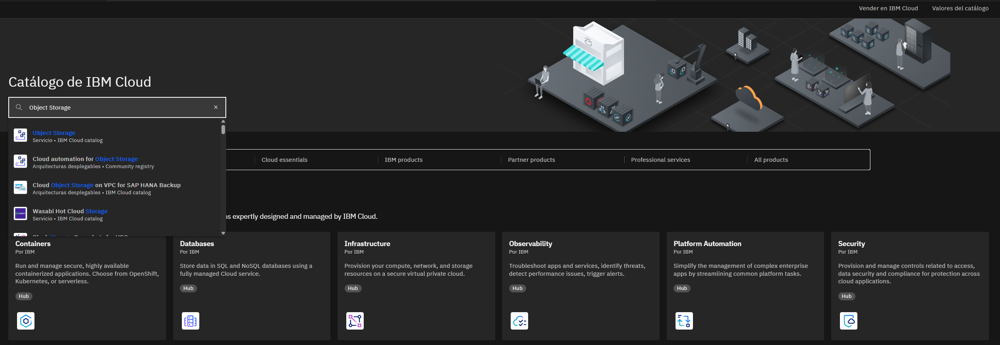

### 2.2 — Configurar la instancia

Selecciona:

- **Plan**: Standard (Pay-as-You-Go con Free Tier incluido)
- **Nombre del servicio**: `Cloud Object Storage-Standard`
- **Resource group**: `test-cos`
- **Tags** (opcional): `icos`, `demo`

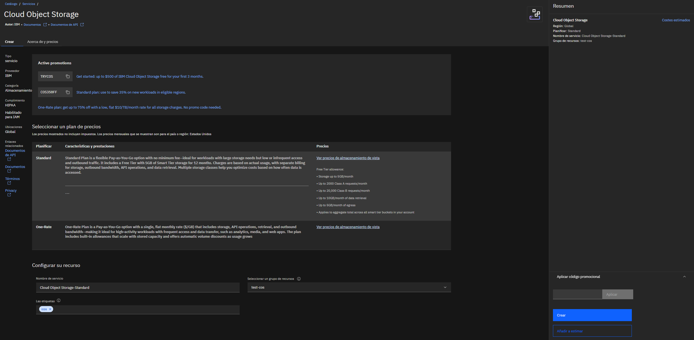

Haz click en **Create**.

### 2.3 — Instancia lista

Una vez creada, verás el panel principal con las pestañas: **Grupos, Credenciales de servicio, Uso de instancia, Cajas fuertes de copia de seguridad, Plan**.

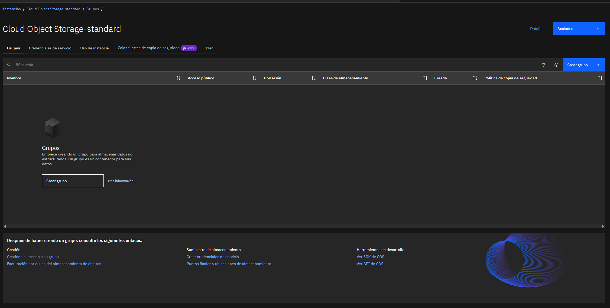

---

## Paso 3 — Crear el bucket

En COS, un **"grupo" (bucket)** es el contenedor donde viven los objetos. Es similar a una carpeta raíz.

### 3.1 — Elegir el tipo de bucket

IBM Cloud ofrece 4 opciones de creación:

| Opción | Cuándo usarla |
|---|---|
| **Crear un grupo personalizado** | Control total sobre todas las opciones ⭐ |
| **Cómo empezar rápidamente** | Smart Tier en us-south con Free Tier, 1 click |
| **Archivar los datos** | Bucket con lifecycle automático a Archive |
| **Alojar un sitio web estático** | Bucket público para HTML/CSS/JS |

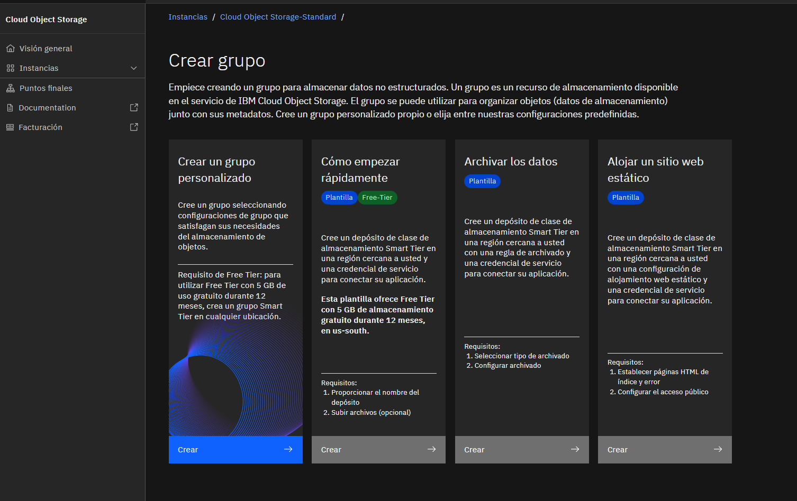

Para este tutorial elegimos **"Crear un grupo personalizado"** porque muestra todas las opciones disponibles.

### 3.2 — Configurar el bucket

| Campo | Valor | Notas |
|---|---|---|
| **Nombre** | `cos-standard-demo-bucket-jsg` | Único globalmente en toda IBM Cloud |
| **Resiliencia** | Regional | Replica en múltiples zonas de 1 región |
| **Ubicación** | us-south (Dallas) | |
| **Clase de almacenamiento** | Smart Tier | Califica para Free Tier |

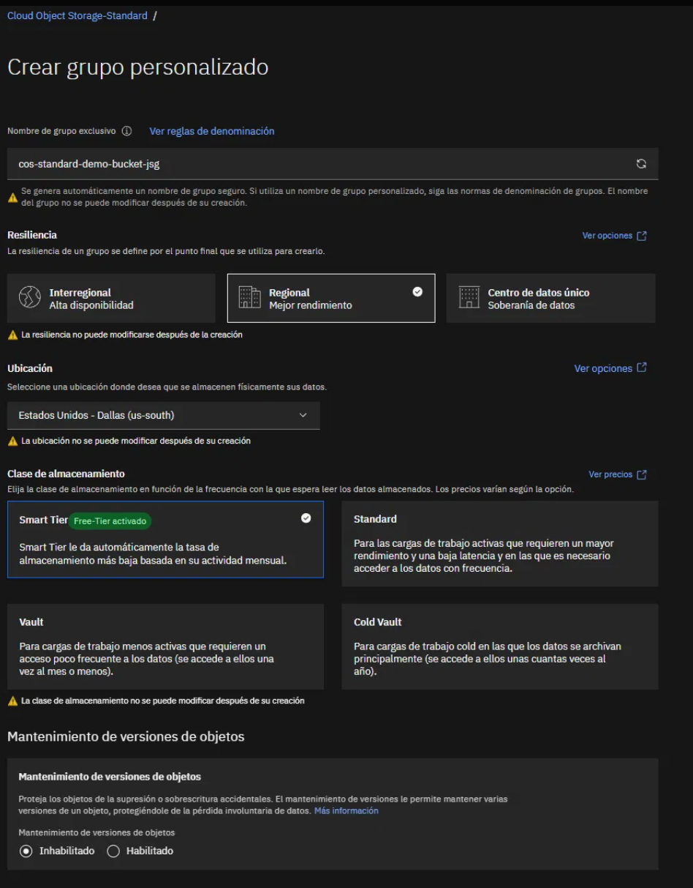

> ⚠️ **Importante**: nombre, resiliencia, ubicación y clase de almacenamiento **no se pueden modificar después de crear el bucket**. Elige con cuidado.

### 3.3 — Opciones avanzadas

El formulario incluye secciones opcionales que vale la pena conocer:

- **Mantenimiento de versiones (Object Versioning)**: protege contra borrados accidentales.
- **Política de retención (Retention)**: impide suprimir o sobrescribir por un periodo.
- **Bloqueo de objetos (Object Lock)**: modelo WORM anti-ransomware.
- **Reglas de archivado y caducidad (Lifecycle)**: automatización del ciclo de vida.
- **Alojamiento de sitio web estático**.
- **Obligatoriedad de cuota**: límite de capacidad.
- **Cifrado (Key management)**: integración con IBM Key Protect o Hyper Protect Crypto Services.

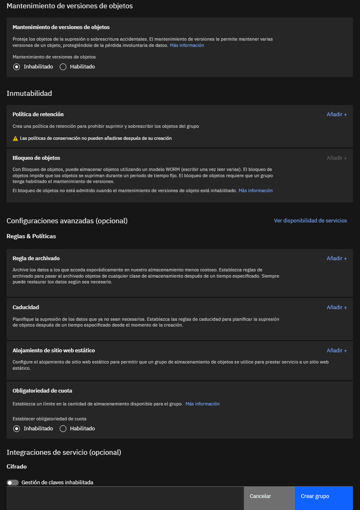

Para esta demo las dejamos todas sin configurar. Click en **Crear grupo**.

### 3.4 — Bucket creado

El bucket vacío aparece con sus pestañas: **Objetos, Visión general, Ciclo de vida, Gestión de datos, Observabilidad, Permisos, Políticas de backup**.

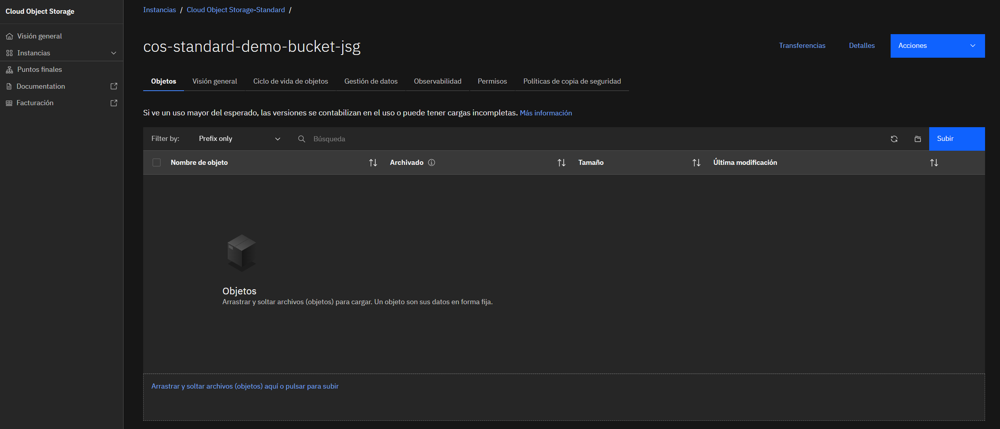

---

## Paso 4 — Subir un objeto

Click en **Subir** y selecciona cualquier archivo (o arrastra y suelta).

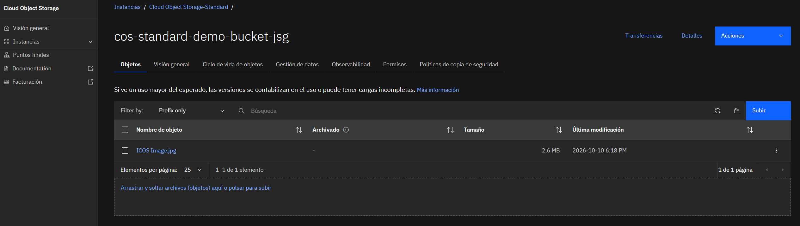

Observa que:

- El objeto se guarda con su **tamaño y fecha de modificación**.
- La columna **"Archivado"** aparece vacía porque está en su clase original (Smart Tier).

---

## Paso 5 — Crear credenciales de servicio con HMAC

Para conectar aplicaciones o herramientas al bucket se necesitan **credenciales**.

### 5.1 — Ir a Credenciales de servicio

En la instancia, pestaña **Credenciales de servicio**. Al inicio está vacía.

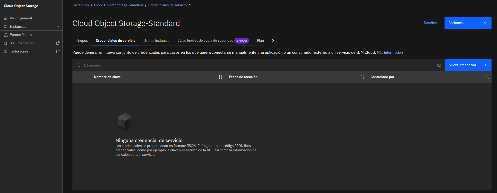

### 5.2 — Crear la credencial

Click en **Nueva credencial**:

| Campo | Valor |
|---|---|
| **Nombre** | `cos-demo-credentials` |
| **Rol** | Escritor (Writer) |
| **ID de servicio** | Generado automáticamente |
| **Incluir credenciales HMAC** | ✅ **ACTIVADO** |

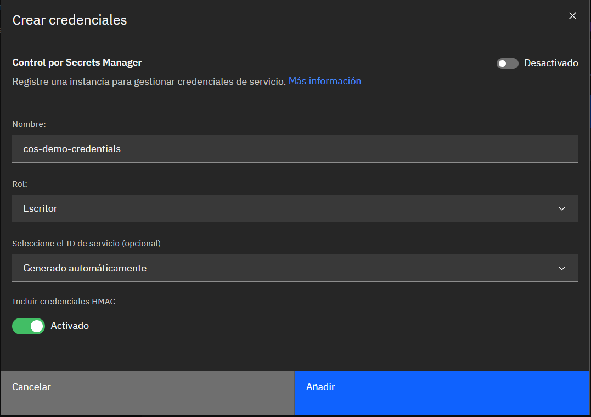

> 💡 **¿Por qué HMAC?** Las credenciales HMAC generan un `access_key_id` y un `secret_access_key` compatibles con el protocolo S3. Esto permite conectar cualquier herramienta del ecosistema S3 (AWS CLI, rclone, Cyberduck, SDKs) directamente al bucket IBM.

### 5.3 — Credencial creada

Aparece en la lista con su fecha de creación.

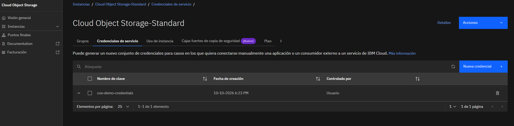

### 5.4 — Ver el JSON de la credencial

Expande la credencial para ver el bloque JSON con `apikey`, `cos_hmac_keys`, `endpoints`, `resource_instance_id`, entre otros.

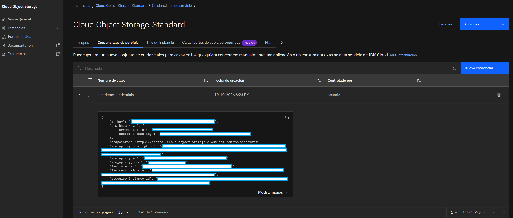

> ⚠️ **Seguridad**: nunca compartas estas credenciales. En este README los valores están ocultos. En producción, usa **IBM Secrets Manager** para gestionarlas con rotación automática.

---

## Paso 6 — Entender los endpoints

COS expone **3 tipos de endpoints** por región. Elegir el correcto impacta el costo y el rendimiento.

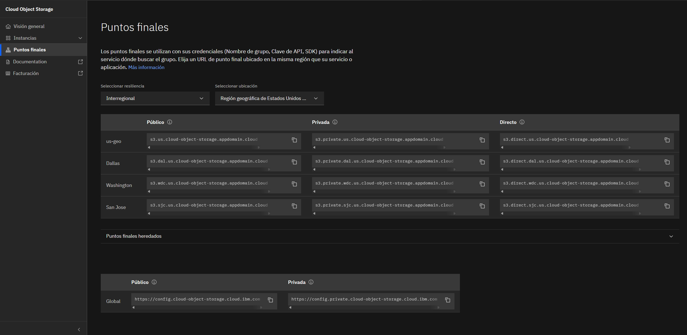

### Tabla comparativa

| Endpoint | Para quién | Costo de egress |
|---|---|---|
| **Public** | Clientes fuera de IBM Cloud (internet) | 💰 Se cobra |
| **Private** | Recursos IBM Cloud **fuera de VPC** (Classic, PowerVS, servicios IBM) | 🆓 Gratis |
| **Direct** | Recursos IBM Cloud **dentro de VPC** (o vía VPE Gateway) | 🆓 Gratis |

### Convención de nombres (Dallas / us-south)

- Public: `s3.dal.us.cloud-object-storage.appdomain.cloud`
- Private: `s3.private.dal.us.cloud-object-storage.appdomain.cloud`
- Direct: `s3.direct.dal.us.cloud-object-storage.appdomain.cloud`

> 💡 **Regla de oro**: siempre que puedas, usa el endpoint **private** o **direct** — reduces costos y mantienes el tráfico dentro de la red privada de IBM.

---

## Paso 7 — Monitorear el uso

La pestaña **Uso de instancia** muestra el consumo mensual por clase de almacenamiento (Smart, Standard, Vault, Cold Vault, Flex).

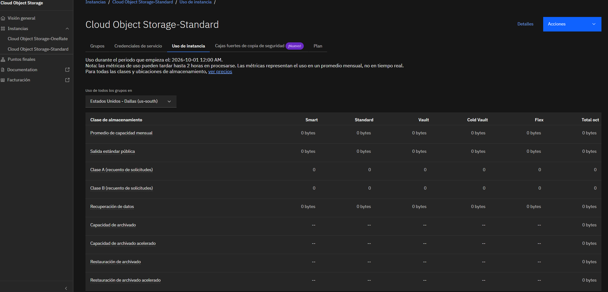

> Las métricas pueden tardar hasta **2 horas** en procesarse. Representan el **promedio mensual**, no tiempo real.

---

## Clases de almacenamiento y precios

El plan Standard permite elegir entre 4 clases según el patrón de acceso.

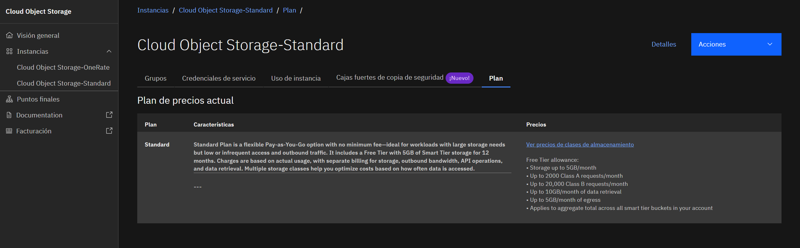

### Comparación rápida (us-south, tarifas al momento de este tutorial)

| Clase | $/GB/mes | Mejor para |
|---|---|---|
| **Smart Tier** | Variable automático | No sabes el patrón de acceso |
| **Standard** | $0.023 | Datos accedidos frecuentemente |
| **Vault** | $0.0125 | Acceso ~1 vez al mes |
| **Cold Vault** | $0.0063 | Archivo (pocas veces al año) |

### Free Tier incluido (12 meses)

- 5 GB/mes de Smart Tier
- 2,000 operaciones Class A/mes
- 20,000 operaciones Class B/mes
- 10 GB/mes de retrieval
- 5 GB/mes de egress

---

## Buenas prácticas

1. **Usa Resource Groups** para organizar recursos por entorno/proyecto.
2. **Habilita versionado** en buckets críticos para protección contra borrados.
3. **Define reglas de lifecycle** para mover datos a Cold Vault o Archive automáticamente.
4. **Elige el endpoint adecuado** según dónde corre tu cliente — ahorra egress.
5. **Guarda las credenciales HMAC en Secrets Manager**, nunca en código fuente ni en repos públicos.
6. **Nombra los buckets con convención clara**: `<empresa>-<proyecto>-<entorno>` facilita el gobierno.
7. **Monitorea el uso mensual** desde la pestaña de métricas.

---

## Recursos adicionales

- [Documentación oficial COS](https://cloud.ibm.com/docs/cloud-object-storage)
- [Comparación de clases de almacenamiento](https://cloud.ibm.com/docs/cloud-object-storage?topic=cloud-object-storage-classes)
- [Endpoints COS](https://cloud.ibm.com/docs/cloud-object-storage?topic=cloud-object-storage-endpoints)
- [SDK y API Reference](https://cloud.ibm.com/apidocs/cos)
- [IBM Secrets Manager](https://cloud.ibm.com/docs/secrets-manager)

---

## 👤 Autor

**Juan Sebastian Galeano**

Especialista en soluciones cloud, con enfoque en IBM Cloud, Data & AI y arquitecturas híbridas.

### 🎓 Certificaciones

- 🏆 **IBM Certified Professional Architect v6 PLUS — Cloud Developer v6**
 *IBM Professional Certification*
- 🏆 **IBM Certified Professional Architect v6 PLUS — Cloud SRE v2**
 *IBM Professional Certification*
- ☁️ **AWS Certified Cloud Practitioner**
 *Amazon Web Services*
- 🤖 **AWS Certified AI Practitioner**
 *Amazon Web Services*

### 🔗 Contacto

- [LinkedIn](https://www.linkedin.com/in/juanse-galeano/?isSelfProfile=true)
- [Credly](https://www.credly.com/users/juan-galeano.8cb6798c/badges/credly)

---

> Este tutorial fue creado como contenido educativo para la comunidad cloud. Si te sirvió, ¡dale una ⭐ al repo!
